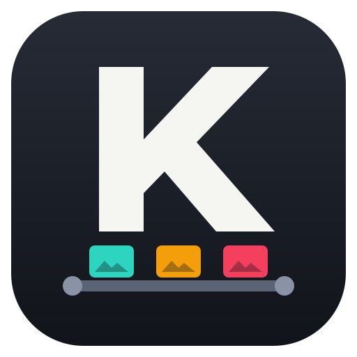

<p align="center">
  
</p>

<h1 align="center">Kimera</h1>

<h3 align="center">Say what the photos need. The Craft apps do it, one after the other.</h3>

<p align="center">
  <a href="README.md">English</a> · <a href="README.pt-BR.md">Português (Brasil)</a>
</p>

<p align="center">
  <b>A photographer's conveyor for LightCraft, PhotoCraft and VectorCraft, written in Rust.</b><br>
  Your AI turns a request into a recipe. Kimera runs the apps' own command-line tools on every photo, headless, and never writes over an original.
</p>

<p align="center">
  <a href="https://www.rust-lang.org"></a>
  <a href="https://github.com/emilk/egui"></a>
  
  
  
  <a href="LICENSE-MIT"></a>
</p>

<br>

<p align="center">
  <a href="#what-it-does">What it does</a> ·
  <a href="#how-a-run-works">How a run works</a> ·
  <a href="#quick-start">Quick start</a> ·
  <a href="#the-window">The window</a> ·
  <a href="#notes-on-a-photo">Notes on a photo</a> ·
  <a href="#command-line">Command line</a> ·
  <a href="#recipes">Recipes</a> ·
  <a href="#what-it-does-not-do">What it does not do</a> ·
  <a href="#development">Development</a>
</p>

<br>

## What it does

Pick a folder, choose one, some or all of the photos, and write what you want: *"remove the
pimples, whiten the teeth, give it a film look, and make a stories version"*. The AI you
configure reads the apps' real command lists and Kimera's [playbook](prompts/playbook.md), and
answers with notes and a recipe. You test it on one photo, look at before and after, then run it
on the rest and watch each photo move along the board.

Kimera works with LightCraft, PhotoCraft and VectorCraft by the ArtCraft team. It is not
affiliated with or endorsed by the ArtCraft team.

- **Only the apps a job needs.** Colour, retouch, masks, crops and exports are LightCraft alone.
  PhotoCraft comes on for pixel work (cut-outs, white backgrounds, text, liquify), VectorCraft for
  layouts. The window shows which apps a recipe turns on; the others stay off.
- **Notes on one photo.** Circle a part and say what to do there: *"remove this sign"*, *"tone
  down this glare"*. Those steps run on that photo only, on top of the recipe.
- **A look at every photo.** Optionally, the AI checks each photo first: red eyes are fixed in
  LightCraft, closed eyes are flagged for review with nearby frames of the same people to swap
  from.
- **Many results per photo.** Variants give feed, stories and square crops, or colour and black
  and white, from one shared edit.
- **Client proof.** A4 contact sheets of the results, as PDF.

## How a run works

```
your folder (read only)
  └─► work/run-<time>/
        1-lightcraft/            masks, colour, retouch   (lightcraft-cli run --import … app.export)
        2-photocraft/            pixel work, if needed    (photocraft-cli run)
        3-stories-lightcraft/    one folder per variant   (feed, stories, B&W…)
```

- Every stage is one app, run headless on one file; its output is the next stage's input.
- Originals are only read, each run gets a new folder, and a stage never writes over its input.
- A photo that fails stops there; the others go on. Steps marked `optional` that find nothing
  (no teeth in the photo, a model not installed) are left out for that photo only.
- *Cancel* stops the running app at once.
- Recipes may come from an AI, so command ids, extensions and export options are checked before
  anything runs, and only commands the apps really have are accepted.

## Quick start

1. **Get Kimera.** On Windows, `scripts\package.ps1` builds
   `dist\Kimera-<version>-windows-x64.zip`; `installer\kimera.iss` (Inno Setup 6) turns it into a
   setup program with a Start menu entry and an "Open in Kimera" item on folders. From source:

   ```sh
   cargo build --release
   ```

   That gives `kimera.exe` (command line) and `kimera-gui.exe` (window) in `target/release/`.
2. **Open Kimera.** The first start shows **Setup**:
   - the paths of `lightcraft-cli`, `photocraft-cli` and, optionally, `vectorcraft-cli`;
   - a work folder for the runs;
   - the AI: **Anthropic** or **OpenAI** (key in `ANTHROPIC_API_KEY` / `OPENAI_API_KEY`, or pasted
     in; `ANTHROPIC_BASE_URL` / `OPENAI_BASE_URL` for gateways), or **Claude Code** / **Codex**
     (the `claude` / `codex` CLIs signed in on this computer).
3. **Save.** The checks show what works and which optional LightCraft models are missing:
   SAM 3 (AI masks), YuNet (automatic blemish removal), the lens database. Each can be installed
   from there.
4. **The apps start with Kimera.** If LightCraft, PhotoCraft or VectorCraft is not running,
   Kimera starts it, in the background by default (LightCraft with its control channel, which
   model installs and `pipeline` use). Setup chooses hidden, minimized or normal windows, or
   turns it off; `kimera --no-open …` skips it once.

Settings live in `kimera.toml` next to the program. `kimera.toml.example` documents every key.

## The window

| Area | What you do there |
|---|---|
| **1 · Photos** | Choose a folder (or right-click a folder → *Open in Kimera*), select one, some or all. |
| **2 · What should happen?** | Describe the edit, then *Write recipe with AI*, or *Change current recipe* to adjust the one on screen. |
| **3 · Recipe** | Read or edit the recipe, open one from `recipes/`, see which apps it turns on. |
| **Photo grid** | *Notes…* on a photo opens the note editor (see below). Double-click does the same. |
| **Run bar** | *Test on 1 photo* (the photo with notes first) shows before / after. *Run on N photos* opens the board: queue, each stage, done, failed, with a live log and *Cancel*. *Client proof (PDF)* after a run. |

## Notes on a photo

1. Open a photo's notes and **drag around the part** you mean. The loop closes by itself.
2. **Write what should happen there** and press Enter. Add as many notes as you need; each gets
   its own colour.
3. Run or test as usual. Before the photo runs, the AI sees it with your loops drawn on it, plus
   their coordinates, and returns steps for that photo only: content-aware removal
   (`spot.add`), or a local mask (object, radial, brush) with its adjustment. If a note needs an
   app the recipe does not use, Kimera turns that app on for the run.

Notes are kept per folder in the work folder, never beside your photos. On the command line,
pass them as JSON with `--notes`:

```json
{
  "D:/shoot/IMG_0412.jpg": [
    { "points": [[0.66, 0.24], [0.76, 0.24], [0.76, 0.36], [0.66, 0.36]], "text": "remove this sign" }
  ]
}
```

## Command line

| Command | What it does |
|---|---|
| `kimera doctor` | Checks the apps, their models, the work folder and the AI. |
| `kimera ask "<request>" <photos> [--run] [--analyse] [--notes FILE]` | The AI writes a recipe: shown, saved, and run with `--run`. |
| `kimera run --recipe <file> <photos> [--analyse] [--notes FILE]` | Runs a recipe. |
| `kimera check <recipes…>` | Checks recipes against the apps' real commands and installed models. |
| `kimera analyse <photos>` | The AI looks at each photo: faces, closed eyes, red eyes. |
| `kimera proof <photos>` | Client proof: A4 contact sheets as PDF. |
| `kimera pipeline --recipe <file> [--ids 12,15] [--reimport]` | Exports photos from a running LightCraft and runs the recipe; `--reimport` stacks the results on their originals. |
| `kimera unimport <run folder>` | Undoes a `--reimport` (the imported results go to Recently Deleted; files stay). |
| `kimera models install sam3\|yunet\|lensdb --accept` | Installs an optional LightCraft model through the running app. |
| `kimera recipes` | Lists the bundled recipes. |

`<photos>` is any mix of files and folders; a folder gives its top-level images.

## Recipes

A recipe is a TOML file. `[[stage]]` tables run in order, one app each. `[[variant]]` tables add
results per photo after the shared stages.

```toml
[[stage]]
app = "lightcraft"
steps = [
  { cmd = "spot.findBlemishes", params = { sensitivity = 45 }, optional = "blemishes" },
  { cmd = "preset.apply", params = { id = "lc.cinematic", amount = 80 } },
  { cmd = "mask.add", params = { kind = "prompt", text = "teeth" }, optional = "teeth" },
  { cmd = "mask.adjust", params = { values = { exposure = 0.15, saturation = -35 } }, optional = "teeth" },
]
export = { format = "tif", bit_depth = 16 }

[[variant]]
name = "stories"
[[variant.stage]]
app = "lightcraft"
steps = [{ cmd = "crop.aspect", params = { aspect = [9, 16] } }]
export = { format = "jpg", long_edge = 1920, options = { watermark = { text = "© Studio" } } }
```

| Key | Meaning |
|---|---|
| `app` | `lightcraft`, `photocraft` or `vectorcraft`. List an app's commands with `<app>-cli commands`. |
| `optional = "<group>"` | When a step of the group fails on a photo, the whole group is left out for that photo and the stage runs again. |
| `export` (LightCraft) | `format`, `long_edge`, `quality`, `bit_depth`, `color_space`, and `options` for any other export option: watermark, `limitKb`, `sharpen`, `metadata`, `removeLocation`… Options that choose where files go are refused. |
| `out_ext` (PhotoCraft) | `tif` between stages; `pcraft` (layers kept) only as the last stage. |
| `template` (VectorCraft) | A layout whose steps place the photo with the `{photo}` placeholder. |

Raw files must meet a LightCraft stage before any PhotoCraft stage. A PhotoCraft stage without
steps is refused in AI recipes: it would only convert the file.

**Bundled:** cinematic clean-up, portrait retouch, social formats (feed, stories, square),
marketplace white background, black and white, web gallery with watermark, print delivery, real
estate, subject mask. `kimera recipes` lists them.

## What it does not do

- **No generative fill.** Neither app can invent content: open an eye, add a smile, extend a busy
  scene. Closed eyes are flagged, with frames to swap from; the swap itself is still by hand.
- **No editing of other people's marks.** Watermarks and credits on images the user does not own
  are not removed, and real-estate or product photos are not changed in ways that mislead.
- **AI masks are slow.** Each photo reloads LightCraft's SAM 3 model, about a minute per photo
  for prompt masks such as "teeth" or "skin".
- **Coordinates are as good as the AI's eye.** Removal and local masks from notes land where the
  AI places them; test on one photo first.
- **Not yet run on a real catalog:** `pipeline --reimport`, `unimport` and model installs need a
  running LightCraft and are written but not verified against a real library. [ROADMAP.md](ROADMAP.md)
  tracks this and the rest.

## Development

```sh
cargo test                       # unit tests, no Craft apps needed
cargo clippy --all-targets       # must be clean
cargo run                        # the window
cargo run --bin kimera -- doctor # the CLI against your kimera.toml
```

| Path | What lives there |
|---|---|
| `src/engine.rs` | The conveyor: stages, variants, optional groups, per-photo steps, events. |
| `src/apps/` | One adapter per Craft CLI; `procrun.rs` runs them and kills them on cancel. |
| `src/recipe.rs` | Recipe format and its checks. |
| `src/writer.rs`, `src/catalog.rs` | Request → recipe with the AI, against the apps' command lists. |
| `src/notes.rs`, `src/analysis.rs` | Notes on one photo; the AI's look at each photo. |
| `src/ai.rs` | Anthropic, OpenAI, Claude Code and Codex behind one call. |
| `src/gui/` | The window. |
| `prompts/playbook.md` | What people ask, mapped to real commands. |

Design rules: no `unwrap`, `expect`, `panic!` or `unsafe` outside tests; every failure is a
message. LightCraft's control channel is loopback only. Prompts and previews go only to the AI
you configure. See [AGENTS.md](AGENTS.md) for working on the code with an AI agent,
[CHANGELOG.md](CHANGELOG.md) for what changed.

## License

MIT or Apache-2.0, at your option.
