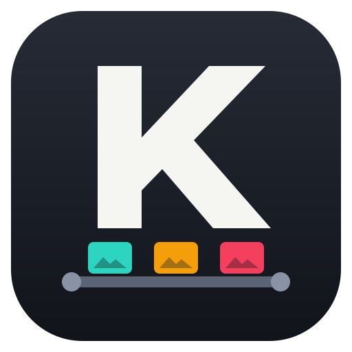

<p align="center">
  
</p>

<h1 align="center">Kimera</h1>

<h3 align="center">Diga o que as fotos precisam. Os apps Craft fazem, um depois do outro.</h3>

<p align="center">
  <a href="README.md">English</a> · <a href="README.pt-BR.md">Português (Brasil)</a>
</p>

<p align="center">
  <b>A esteira do fotógrafo para LightCraft, PhotoCraft e VectorCraft, escrita em Rust.</b><br>
  A sua IA transforma um pedido numa receita. O Kimera roda as ferramentas de linha de comando dos próprios apps em cada foto, sem abrir janela, e nunca grava por cima de um original.
</p>

<p align="center">
  <a href="https://www.rust-lang.org"></a>
  <a href="https://github.com/emilk/egui"></a>
  
  
  
  <a href="LICENSE-MIT"></a>
</p>

<br>

<p align="center">
  <a href="#o-que-ele-faz">O que ele faz</a> ·
  <a href="#como-uma-execução-funciona">Como funciona</a> ·
  <a href="#começo-rápido">Começo rápido</a> ·
  <a href="#a-janela">A janela</a> ·
  <a href="#anotações-numa-foto">Anotações</a> ·
  <a href="#linha-de-comando">Linha de comando</a> ·
  <a href="#receitas">Receitas</a> ·
  <a href="#o-que-ele-não-faz">O que ele não faz</a> ·
  <a href="#desenvolvimento">Desenvolvimento</a>
</p>

<br>

## O que ele faz

Escolha uma pasta, marque uma, algumas ou todas as fotos e escreva o que quer: *"tira as
espinhas, clareia os dentes, dá um look de cinema e faz uma versão stories"*. A IA que você
configurar lê as listas reais de comandos dos apps e o [playbook](prompts/playbook.md) do
Kimera, e responde com notas e uma receita. Você testa numa foto, compara antes e depois, roda
no resto e acompanha cada foto andando pelo quadro.

O Kimera funciona com LightCraft, PhotoCraft e VectorCraft, da equipe ArtCraft. Não é afiliado
nem endossado pela equipe ArtCraft.

- **Só os apps que o trabalho pede.** Cor, retoque, máscaras, cortes e exportação são só
  LightCraft. O PhotoCraft liga para trabalho de pixel (recorte, fundo branco, texto, liquify) e o
  VectorCraft para layouts. A janela mostra quais apps a receita liga; os outros ficam desligados.
- **Anotações numa foto.** Circule uma parte e diga o que fazer ali: *"tira essa placa"*,
  *"suaviza esse reflexo"*. Esses passos rodam só naquela foto, por cima da receita.
- **Um olhar em cada foto.** Se quiser, a IA confere cada foto antes: olho vermelho é corrigido no
  LightCraft, olho fechado é marcado para revisão, com fotos vizinhas das mesmas pessoas para
  trocar os olhos.
- **Vários resultados por foto.** Variantes geram feed, stories e quadrado, ou cor e preto e
  branco, a partir de uma edição em comum.
- **Prova para o cliente.** Folhas de contato A4 dos resultados, em PDF.

## Como uma execução funciona

```
sua pasta (só leitura)
  └─► work/run-<hora>/
        1-lightcraft/            máscaras, cor, retoque     (lightcraft-cli run --import … app.export)
        2-photocraft/            trabalho de pixel, se fizer falta  (photocraft-cli run)
        3-stories-lightcraft/    uma pasta por variante     (feed, stories, PB…)
```

- Cada etapa é um app rodando sem janela num arquivo; a saída dela é a entrada da próxima.
- Os originais são só lidos, cada execução ganha uma pasta nova e nenhuma etapa grava por cima
  da entrada.
- Uma foto que falha para ali; as outras continuam. Passos marcados `optional` que não acham
  nada (foto sem dentes à mostra, modelo não instalado) saem só daquela foto.
- *Cancel* para o app na hora.
- Receitas podem vir de uma IA, então ids de comando, extensões e opções de exportação são
  conferidos antes de qualquer coisa rodar, e só comandos que os apps realmente têm são aceitos.

## Começo rápido

1. **Pegue o Kimera.** No Windows, `scripts\package.ps1` gera
   `dist\Kimera-<versão>-windows-x64.zip`; `installer\kimera.iss` (Inno Setup 6) transforma isso
   num instalador com atalho no menu Iniciar e um item "Open in Kimera" nas pastas. Pelo
   código-fonte:

   ```sh
   cargo build --release
   ```

   Isso gera `kimera.exe` (linha de comando) e `kimera-gui.exe` (janela) em `target/release/`.
2. **Abra o Kimera.** Na primeira vez aparece o **Setup**:
   - os caminhos do `lightcraft-cli`, do `photocraft-cli` e, se quiser, do `vectorcraft-cli`;
   - uma pasta de trabalho para as execuções;
   - a IA: **Anthropic** ou **OpenAI** (chave em `ANTHROPIC_API_KEY` / `OPENAI_API_KEY`, ou colada
     no campo; `ANTHROPIC_BASE_URL` / `OPENAI_BASE_URL` para gateways), ou **Claude Code** /
     **Codex** (os CLIs `claude` / `codex` logados neste computador).
3. **Save.** As verificações mostram o que funciona e quais modelos opcionais do LightCraft
   faltam: SAM 3 (máscaras com IA), YuNet (tirar espinhas sozinho), base de lentes. Cada um pode
   ser instalado dali, por um `lightcraft --control 7980` aberto.

As configurações ficam em `kimera.toml`, ao lado do programa. O `kimera.toml.example` explica
cada chave.

## A janela

| Área | O que você faz ali |
|---|---|
| **1 · Photos** | Escolha a pasta (ou clique direito numa pasta → *Open in Kimera*) e marque uma, algumas ou todas. |
| **2 · What should happen?** | Descreva a edição e clique em *Write recipe with AI*, ou em *Change current recipe* para ajustar a receita da tela. |
| **3 · Recipe** | Leia ou edite a receita, abra uma de `recipes/`, veja quais apps ela liga. |
| **Grade de fotos** | *Notes…* numa foto abre o editor de anotações (abaixo). O clique duplo faz o mesmo. |
| **Barra de execução** | *Test on 1 photo* (a foto com anotações primeiro) mostra antes e depois. *Run on N photos* abre o quadro: fila, cada etapa, pronta, falhou, com log ao vivo e *Cancel*. *Client proof (PDF)* depois de uma execução. |

## Anotações numa foto

1. Abra as anotações de uma foto e **arraste em volta da parte** que você quer. O laço fecha
   sozinho.
2. **Escreva o que deve acontecer ali** e aperte Enter. Faça quantas anotações precisar; cada uma
   ganha uma cor.
3. Rode ou teste normalmente. Antes de a foto rodar, a IA vê a foto com os seus laços desenhados,
   mais as coordenadas, e devolve passos só para aquela foto: remoção com preenchimento
   inteligente (`spot.add`) ou uma máscara local (objeto, radial, pincel) com o ajuste. Se uma
   anotação precisar de um app que a receita não usa, o Kimera liga esse app na execução.

As anotações ficam guardadas por pasta, dentro da pasta de trabalho, nunca ao lado das suas
fotos. Na linha de comando, passe em JSON com `--notes`:

```json
{
  "D:/ensaio/IMG_0412.jpg": [
    { "points": [[0.66, 0.24], [0.76, 0.24], [0.76, 0.36], [0.66, 0.36]], "text": "tira essa placa" }
  ]
}
```

## Linha de comando

| Comando | O que faz |
|---|---|
| `kimera doctor` | Confere os apps, os modelos, a pasta de trabalho e a IA. |
| `kimera ask "<pedido>" <fotos> [--run] [--analyse] [--notes ARQ]` | A IA escreve a receita: mostra, salva e roda com `--run`. |
| `kimera run --recipe <arquivo> <fotos> [--analyse] [--notes ARQ]` | Roda uma receita. |
| `kimera check <receitas…>` | Confere receitas contra os comandos reais dos apps e os modelos instalados. |
| `kimera analyse <fotos>` | A IA olha cada foto: rostos, olhos fechados, olho vermelho. |
| `kimera proof <fotos>` | Prova do cliente: folhas de contato A4 em PDF. |
| `kimera pipeline --recipe <arquivo> [--ids 12,15] [--reimport]` | Exporta fotos de um LightCraft aberto e roda a receita; `--reimport` empilha os resultados nos originais. |
| `kimera unimport <pasta da execução>` | Desfaz um `--reimport` (os resultados importados vão para a lixeira do LightCraft; os arquivos ficam). |
| `kimera models install sam3\|yunet\|lensdb --accept` | Instala um modelo opcional do LightCraft pelo app aberto. |
| `kimera recipes` | Lista as receitas que vêm com o Kimera. |

`<fotos>` é qualquer mistura de arquivos e pastas; uma pasta entrega as imagens do primeiro nível.

## Receitas

Uma receita é um arquivo TOML. Tabelas `[[stage]]` rodam em ordem, um app cada. Tabelas
`[[variant]]` acrescentam resultados por foto depois das etapas em comum.

```toml
[[stage]]
app = "lightcraft"
steps = [
  { cmd = "spot.findBlemishes", params = { sensitivity = 45 }, optional = "blemishes" },
  { cmd = "preset.apply", params = { id = "lc.cinematic", amount = 80 } },
  { cmd = "mask.add", params = { kind = "prompt", text = "teeth" }, optional = "teeth" },
  { cmd = "mask.adjust", params = { values = { exposure = 0.15, saturation = -35 } }, optional = "teeth" },
]
export = { format = "tif", bit_depth = 16 }

[[variant]]
name = "stories"
[[variant.stage]]
app = "lightcraft"
steps = [{ cmd = "crop.aspect", params = { aspect = [9, 16] } }]
export = { format = "jpg", long_edge = 1920, options = { watermark = { text = "© Studio" } } }
```

| Chave | Significado |
|---|---|
| `app` | `lightcraft`, `photocraft` ou `vectorcraft`. Liste os comandos de um app com `<app>-cli commands`. |
| `optional = "<grupo>"` | Quando um passo do grupo falha numa foto, o grupo inteiro sai daquela foto e a etapa roda de novo. |
| `export` (LightCraft) | `format`, `long_edge`, `quality`, `bit_depth`, `color_space`, e `options` para qualquer outra opção de exportação: marca d'água, `limitKb`, `sharpen`, `metadata`, `removeLocation`… Opções que mudam onde o arquivo é salvo são recusadas. |
| `out_ext` (PhotoCraft) | `tif` entre etapas; `pcraft` (mantém camadas) só na última. |
| `template` (VectorCraft) | Um layout cujos passos posicionam a foto com o marcador `{photo}`. |

Arquivos raw precisam passar por uma etapa do LightCraft antes de qualquer etapa do PhotoCraft.
Uma etapa do PhotoCraft sem passos é recusada nas receitas da IA, porque só converteria o
arquivo.

**Incluídas:** limpeza cinematográfica, retoque de retrato, formatos de rede social (feed,
stories, quadrado), fundo branco de marketplace, preto e branco, galeria web com marca d'água,
entrega para impressão, imobiliário e máscara de sujeito. `kimera recipes` lista todas.

## O que ele não faz

- **Não preenche com IA generativa.** Nenhum dos apps inventa conteúdo: abrir um olho, pôr um
  sorriso, estender uma cena cheia. Olho fechado é marcado, com fotos vizinhas para a troca; a
  troca em si ainda é manual.
- **Não mexe em marcas dos outros.** Marcas d'água e créditos em imagens que não são do usuário
  não são removidos, e fotos de imóvel ou produto não são alteradas de um jeito que engane.
- **Máscaras com IA são lentas.** Cada foto recarrega o SAM 3 do LightCraft, cerca de um minuto
  por foto para máscaras por texto como "dentes" ou "pele".
- **As coordenadas são tão boas quanto o olho da IA.** Remoções e máscaras vindas de anotações
  caem onde a IA posiciona; teste numa foto antes.
- **Ainda não testado num catálogo real:** `pipeline --reimport`, `unimport` e a instalação de
  modelos precisam de um LightCraft aberto e estão escritos, mas não foram verificados numa
  biblioteca real. O [ROADMAP.md](ROADMAP.md) acompanha isso e o resto.

## Desenvolvimento

```sh
cargo test                       # testes, sem precisar dos apps Craft
cargo clippy --all-targets       # precisa ficar limpo
cargo run                        # a janela
cargo run --bin kimera -- doctor # o CLI com o seu kimera.toml
```

| Caminho | O que fica ali |
|---|---|
| `src/engine.rs` | A esteira: etapas, variantes, grupos opcionais, passos por foto, eventos. |
| `src/apps/` | Um adaptador por CLI Craft; `procrun.rs` roda e mata no cancelar. |
| `src/recipe.rs` | O formato da receita e as conferências. |
| `src/writer.rs`, `src/catalog.rs` | Pedido → receita com a IA, contra as listas de comandos dos apps. |
| `src/notes.rs`, `src/analysis.rs` | Anotações numa foto; o olhar da IA em cada foto. |
| `src/ai.rs` | Anthropic, OpenAI, Claude Code e Codex atrás de uma chamada só. |
| `src/gui/` | A janela. |
| `prompts/playbook.md` | O que as pessoas pedem, ligado aos comandos reais. |

Regras de projeto: nada de `unwrap`, `expect`, `panic!` ou `unsafe` fora dos testes; toda falha
vira mensagem. O canal de controle do LightCraft é só local. Pedidos e miniaturas vão só para a
IA que você configurar. Veja o [AGENTS.md](AGENTS.md) para trabalhar no código com um agente de
IA, e o [CHANGELOG.md](CHANGELOG.md) para o que mudou.

## Licença

MIT ou Apache-2.0, à sua escolha.
